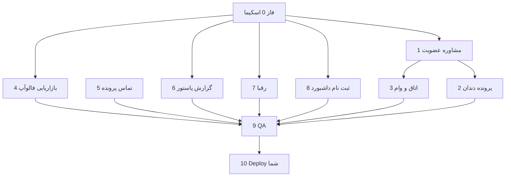

# TODO v23 — پاستور پلاس / pasteurmed10tir

**سند فعال بعد از v22** — بازخورد **بسته ۲۹** · [`updates/29/todo-baste-29.md`](updates/29/todo-baste-29.md) · پوشه‌های `updates/29/01`–`17`

**پیش‌نیاز:** `todo-v22.md` (بسته ۲۸) · migration تا `057_installment_documents` · deploy v22 روی Runflare

**منابع بسته ۲۹:**

| پوشه | موضوع |
|------|--------|
| ۲۹/۰۱ | حذف اورژانسی تکراری · ویزیت تصویری |
| ۲۹/۰۲ | گزارش کلی تکفل — نام در سربرگ |
| ۲۹/۰۳ | مشاوره دندان — بدون Quick Links تخصصی |
| ۲۹/۰۴ | ادمین قیمت = سایت |
| ۲۹/۰۵ | VIP ۲M · عادی ۱M |
| ۲۹/۰۶ | لینک اتاق متنی/صوتی در ادمین |
| ۲۹/۰۷ | گزارش کار پاستور (۷ بخش) |
| ۲۹/۰۸ | توضیحات موفق بازاریابی · تحلیل رقبا · عکس تعرفه |
| ۲۹/۰۹ | طرح تحلیل رقبا (مراکز · قیمت از تعرفه) |
| ۲۹/۱۰ | ویرایش نتیجه ویزیت بازاریابی |
| ۲۹/۱۱ | تماس با ما — گروه شماره |
| ۲۹/۱۲ | فالوآپ — معرفی به آشنایان ۱–۵ |
| ۲۹/۱۳ | نحوه آشنایی — دو گزینه جدید |
| ۲۹/۱۴ | داشبورد — نرخ بازگشت بیمار |
| ۲۹/۱۵ | تأیید کاربری — کد معرف |
| ۲۹/۱۶ | (متن در ۱۵/۱۴) |
| ۲۹/۱۷ | محاسبه‌گر وام — سقف ۳۰۳M |

**آخرین به‌روزرسانی سند:** ۱۴۰۵/۰۷/۳۰ (۲۰۲۶-۱۰-۲۱) · **Deploy:** push + `migrate deploy` 058+**059** ☐  
**UAT-1:** [`updates/29/29-first test/uat-v23-report.md`](updates/29/29-first%20test/uat-v23-report.md) (۱۵ pass · ۵ fail · ۱۱ blocked)  
**پس از اسپرینت post-UAT:** فیکس emergency (059) · export فالوآپ · UI پاستور ۷بخش · فرم رقبا · 4.9 · 8.9 · **UAT-2** ☐

*Legend: ✅ done · 🔄 in progress · ☐ pending*

---

## خلاصه درخواست‌ها (بسته ۲۹)

| # | موضوع | فاز | وضعیت |
|---|--------|-----|--------|
| 1 | انواع مشاوره — بدون تکرار اورژانسی | 1 | ✅ *(تست روی `?category=dental`؛ migration 059 emergency)* |
| 2 | گزارش پرونده — سربرگ تکفل | 2 | ✅ |
| 3 | دندان — Quick Links | 2 | ✅ |
| 4 | ادمین قیمت مشاوره | 1 | ✅ |
| 5 | عضویت VIP/عادی قیمت | 1 | ✅ *(migration داده)* |
| 6 | ادمین — اتاق متنی/صوتی | 3 | ✅ |
| 7 | گزارش کار پاستور | 6 | ✅ *(UI ۷ بخش + reportedAt)* |
| 8 | بازاریابی — توضیحات موفق | 4 | ✅ |
| 9 | تحلیل رقبا | 7 | ✅ *(فرم کامل فیلدها)* |
| 10 | تعرفه دندان — عکس | 7 | ✅ *(URL)* |
| 11 | بازاریابی — ویرایش فرم | 4 | ✅ |
| 12 | مدارک بیمارستان | 5 | ✅ |
| 13 | تماس با ما | 5 | ✅ |
| 14 | فالوآپ NPS معرفی | 4 | ✅ |
| 15 | نحوه آشنایی enum | 0 + 8 | ✅ |
| 16 | نرخ بازگشت بیمار | 8 | ✅ |
| 17 | کد معرف تأیید کاربری | 8 | ✅ |
| 18 | محاسبه‌گر وام | 3 | ✅ |

---

## برآورد فازها

| فاز | عنوان | migration | وضعیت |
|-----|--------|-----------|--------|
| 0 | اسکیما + داده پایه | `058_v23_*` | ✅ |
| 1 | مشاوره + قیمت + عضویت | داده ConsultationType / MembershipPlan | ✅ |
| 2 | پرونده · دندان · UX سریع | — | ✅ |
| 3 | اتاق متنی/صوتی + وام | — (منطق API) | ✅ |
| 4 | بازاریابی + فالوآپ | MarketingReport · FollowUpCase | ✅ |
| 5 | تماس · پرونده بیمارستان | — / بخش health | ✅ |
| 6 | گزارش کار پاستور | PasteurWorkReport | ✅ |
| 7 | تحلیل رقبا + عکس تعرفه | Competitor* · DentalTariff | ✅ |
| 8 | ثبت‌نام · داشبورد · معرف | AcquisitionSource · PatientProfile | ✅ |
| 9 | QA محلی + UAT مرورگر | — | 🔄 *(UAT-1 ✅ · UAT-2 بعد از deploy 059)* |
| 10 | Deploy (شما) + UAT production | `migrate deploy` | ☐ |

---

## فاز ۰ — Prisma / migration / seed داده

**فایل‌ها:** `058_v23_bundle29` · `059_consultation_emergency_type` (INSERT `emergency`)  
**به‌روزرسانی:** `prisma/schema.prisma` · در صورت نیاز `scripts/restore-migration-sql.cjs`

### بک‌اند / DB

- [x] ۰.۱ `enum AcquisitionSource` — `organizational_contracts` · `clinic_patient`
- [x] ۰.۲ `MarketingReport.successNotes` — `TEXT` nullable
- [x] ۰.۳ `FollowUpCase.referralLikelihood` — `Int` nullable (۱–۵)
- [x] ۰.۴ `PasteurWorkReport.reportedAt` — `DateTime` · `payloadJson` — `Json` (ساختار ۷ بخش)
- [x] ۰.۵ مدل `CompetitorClinic` — فیلدهای بخش‌های ۱–۶ + `notes` · `createdAt` · `updatedAt` (+ `clinicName` · `city` · `region` · … طبق ۲۹/۰۸)
- [x] ۰.۶ مدل `CompetitorClinicPrice` — `competitorId` · `dentalTariffItemId` · `priceNum` (unique روی جفت)
- [x] ۰.۷ `PatientProfile.referralCode` — `String?` · index در صورت گزارش
- [x] ۰.۸ `DentalTariffCategory.image` — `String?` (URL)
- [x] ۰.۹ migration داده: `ConsultationType` — حذف/غیرفعال `image` · برچسب `video`/`emergency` · قیمت ۱M/۱٫۳M
- [x] ۰.۱۰ migration داده: `MembershipPlan` — regular `priceNum=1000000` · VIP `2000000` · `loanLimit` ۳۰۳M / ۶۰۶M
- [ ] ۰.۱۱ `npx prisma migrate dev` (لوکال) · commit migration *(فایل migration commit شده؛ اجرا روی DB شما)*

### فرانت

- [x] ۰.۱۲ تایپ‌های TS از Prisma regenerate (`npx prisma generate`)

---

## فاز ۱ — مشاوره · ادمین قیمت · عضویت (بسته ۲۹/۰۱ · ۰۴ · ۰۵)

### بک‌اند

- [x] ۱.۱ `app/api/content/consultation-pricing/route.ts` — فیلتر انواع: فقط `text`|`phone`|`video`|`emergency` (نه `image` در API عمومی)
- [x] ۱.۲ `app/api/admin/content/consultation-pricing/route.ts` — همان فیلتر + validation id
- [x] ۱.۳ `lib/consultation/type-id.ts` · `lib/consultationPrice.ts` — alias `image`→`video` در lookup (اگر رکورد legacy مانده)
- [ ] ۱.۴ `scripts/seed-phase2.ts` یا اسکریپت one-off — چهار نوع استاندارد پس از deploy *(داده در migration 058؛ اسکریپت جدا اختیاری)*

### فرانت

- [x] ۱.۵ `components/consultation/ConsultationForm.tsx` — چهار کارت بدون تکرار برچسب اورژانسی
- [x] ۱.۶ `app/admin/(panel)/consultation-prices/page.tsx` — نمایش/ویرایش چهار id · هشدار id اضافی · ستون تعرفه `general` برای هر چهار نوع
- [x] ۱.۷ `components/dental/MembershipPage.tsx` — قیمت از `getMembershipPlansAsync` (نه stale localStorage)
- [x] ۱.۸ `lib/membership/server-plans.ts` — تأیید sync با DB

### چک smoke لوکال

- [ ] ۱.۹ `/consultation?category=medical` — چهار نوع · قیمت‌ها با ادمین یکسان *(UAT کوپایلت — سناریو ۱)*
- [ ] ۱.۱۰ `/dental/membership` — VIP ۲٬۰۰۰٬۰۰۰ · عادی ۱٬۰۰۰٬۰۰۰ *(UAT — سناریو ۲)*

**ارجاع:** `lib/data.ts` · `lib/consultation/modality.ts` · `ROUTES.admin.consultationPrices` · `ROUTES.web.dentalMembership`

---

## فاز ۲ — پرونده تکفل · مشاوره دندان (۲۹/۰۲ · ۰۳)

### بک‌اند

- [x] ۲.۱ `app/api/operations/health-record/entries/route.ts` — بدون تغییر اگر `dependentId` کافی است
- [x] ۲.۲ (اختیاری) API کوتاه `GET /api/auth/dependents/[id]` برای سربرگ گزارش *(از لیست `/api/auth/dependents` استفاده شد)*

### فرانت

- [x] ۲.۳ `components/health-record/HealthRecordReportPage.tsx` — سربرگ «بیمار» = نام تکفل + کد ملی تکفل وقتی `dependentId` ست است
- [x] ۲.۴ `components/consultation/ConsultationPageContent.tsx` — `focused` = true اگر `category=dental` **یا** دسته پیش‌فرض فرم dental (هم‌ترازی با `ConsultationForm`)
- [x] ۲.۵ `components/consultation/ConsultationQuickLinks.tsx` — عدم رندر در مسیر دندان

### چک smoke

- [ ] ۲.۶ `/account/health-record/report` — selector تکفل · نام سربرگ ≠ سرپرست *(UAT — سناریو ۴)*
- [ ] ۲.۷ `/consultation` و `/consultation?category=dental` — بدون بلوک «خدمات تخصصی — تماس کارشناس» *(UAT — سناریو ۳)*

---

## فاز ۳ — اتاق ادمین متنی/صوتی · وام (۲۹/۰۶ · ۱۷ · تکمیل v22 فاز ۱۰)

### بک‌اند

- [x] ۳.۱ `lib/consultation/modality.ts` — تابع جدید مثلاً `consultationSupportsConsultationRoom` برای `text`|`phone`|`video`|`emergency` (جدا از `consultationSupportsVideoSession`)
- [x] ۳.۲ `app/api/admin/operations/consultations/route.ts` — PATCH/POST باز کردن session برای متنی/صوتی (Jitsi بدون اجبار ویدیو یا `videoMeetingUrl` دستی)
- [x] ۳.۳ `lib/jitsi/consultation-video.ts` — شاخه modality · SMS همان مسیر patient track
- [x] ۳.۴ `app/api/commerce/membership-plans` (یا موجود) — loanLimit در پاسخ API

### فرانت

- [x] ۳.۵ `app/admin/(panel)/consultations/page.tsx` — دکمه «ایجاد لینک» برای type=text/phone · نمایش URL
- [x] ۳.۶ `components/consultation/ConsultationTrack.tsx` — تأیید ویدیو off برای text/phone (موجود؛ regression)
- [x] ۳.۷ `components/account/LoanRequestCard.tsx` — `getMembershipPlansAsync()` در `useEffect` · cap ورودی amount به `loanPreview.limit` · نمایش سقف ۳۰۳M/۶۰۶M

### چک smoke

- [ ] ۳.۸ ادمین: مشاوره متنی paid → لینک اتاق · بیمار `/account/consultations/[id]` *(UAT — سناریو ۵)*
- [ ] ۳.۹ `/app/account` → درخواست وام — تغییر مبلغ بالای سقف clamp/خطا *(UAT — سناریو ۶)*

---

## فاز ۴ — بازاریابی · فالوآپ (۲۹/۰۷ · ۰۸ · ۱۰ · ۱۲)

### بک‌اند

- [x] ۴.۱ `lib/marketing/service.ts` · `parseCreateMarketingReportBody` — `successNotes`
- [x] ۴.۲ `lib/marketing/mappers.ts` — map فیلد جدید
- [x] ۴.۳ `app/api/operations/marketing/reports/route.ts` · `[id]/route.ts` — PATCH ویرایش کامل outcome + flags + notes (اگر نیست)
- [x] ۴.۴ `lib/admin/follow-up-service.ts` · `app/api/admin/operations/follow-up/cases/route.ts` — `referralLikelihood`
- [x] ۴.۵ `lib/admin/follow-up-export.ts` — ستون NPS معرفی در CSV/Excel/HTML

### فرانت

- [x] ۴.۶ `components/account/MarketingPanel.tsx` — textarea توضیحات زیر «اقدامات موفق»
- [x] ۴.۷ `MarketingPanel.openEditForm` — پر کردن `successFlags` · `contractDate` · `unsuccessful*` · `followUp*` · `successNotes`
- [x] ۴.۸ `app/admin/(panel)/follow-up/page.tsx` — تب «جدید» · `RatingSelect` برای سؤال معرفی ۱–۵
- [x] ۴.۹ `app/admin/(panel)/marketing-reports/page.tsx` — نمایش `successNotes` در جزئیات

### چک smoke

- [ ] ۴.۱۰ `/app/account` — بازاریابی · ثبت موفق + توضیحات · ویرایش از لیست *(UAT — سناریو ۷)*
- [ ] ۴.۱۱ `/admin/follow-up` — ثبت case با referralLikelihood · export *(UAT — سناریو ۸)*

---

## فاز ۵ — تماس · مدارک بیمارستان (۲۹/۱۱ · ۱۰)

### بک‌اند

- [x] ۵.۱ `lib/data.ts` — ساختار `institute.phones` گروه‌بندی (دندان · پزشکی · فروشگاه) یا فیلد جدا
- [x] ۵.۲ `app/api/operations/health-record/entries` + آپلود — بخش `other` (مدارک بیمارستان) با فیلدهای payload

### فرانت

- [x] ۵.۳ `app/(site)/contact/page.tsx` · `app/app/contact/page.tsx` — UI سه گروه شماره (۲۹/۱۱)
- [x] ۵.۴ `lib/health-record/sections.ts` — `other` · label «مدارک بیمارستان» · فیلدهای: `summary` · `course` · `dischargeEducation` · `otherNotes`
- [x] ۵.۵ `components/health-record/*` — آپلود پیوست برای همان رکورد *(یک ورودی per ثبت؛ نه چهار رکورد جدا)*

### چک smoke

- [ ] ۵.۶ `/contact` — سه بلوک شماره *(UAT — سناریو ۹)*
- [ ] ۵.۷ `/account/health-record` — بخش مدارک بیمارستان · آپلود · نمایش در گزارش *(UAT — سناریو ۱۰)*

---

## فاز ۶ — گزارش کار پاستور (۲۹/۰۷)

### بک‌اند

- [x] ۶.۱ `lib/pasteur-work-report/payload.ts` — نوع/parse `payloadJson` · ۷ بخش × ۷ ردیف + بخش ۷ تک فیلد *(بدون فایل Zod جدا)*
- [x] ۶.۲ `app/api/admin/operations/pasteur-work-reports/route.ts` — POST/PATCH با `reportedAt` + validate JSON
- [ ] ۶.۳ (اختیاری) export CSV گزارش‌های کار

### فرانت

- [x] ۶.۴ `app/admin/(panel)/pasteur-work-reports/page.tsx` — فرم کامل ۷ بخش · datetime ثبت · لیست · مشاهده/ویرایش
- [x] ۶.۵ `lib/adminAccess.ts` · `AdminShell` — بدون تغییر مسیر `/admin/pasteur-work-reports`

### چک smoke

- [ ] ۶.۶ `/admin/pasteur-work-reports` — ثبت · ذخیره · بازخوانی · ویرایش *(UAT — سناریو ۱۱ **blocked** تا UI ۶.۴)*

---

## فاز ۷ — تحلیل رقبا · عکس تعرفه (۲۹/۰۸ · ۰۹)

### بک‌اند

- [x] ۷.۱ `app/api/admin/operations/competitor-clinics/route.ts` — CRUD لیست مراکز
- [x] ۷.۲ `app/api/admin/operations/competitor-clinics/[id]/route.ts` — GET/PATCH · `updatedAt` auto · sync قیمت‌ها
- [x] ۷.۳ sync قیمت در PATCH `[id]` *(مسیر جدا `/prices` نیست)*
- [x] ۷.۴ `image` در ادمین تعرفه — **فقط URL** در UI *(آپلود فایل ☐)*
- [x] ۷.۵ permission — همان `dental-tariffs` برای API/UI *(permission جدا `competitor-analysis` ☐)*

### فرانت

- [x] ۷.۶ `app/admin/(panel)/competitor-analysis/page.tsx` — تب **جدید** · **مراکز** · قیمت تعرفه · فیلدهای عددی/متنی کامل
- [x] ۷.۷ `app/admin/(panel)/dental-tariffs/page.tsx` — فیلد URL عکس دسته
- [x] ۷.۸ `components/admin/AdminShell.tsx` — منوی «تحلیل رقبا»
- [x] ۷.۹ `lib/routes.ts` — `ROUTES.admin.competitorAnalysis`

### چک smoke

- [ ] ۷.۱۰ `/admin/competitor-analysis` — ایجاد مرکز · لیست قیمت از تعرفه · ذخیره · ویرایش مجدد *(UAT — سناریو ۱۲)*
- [ ] ۷.۱۱ `/admin/dental-tariffs` — URL عکس · نمایش در `/dental/tariffs` *(صفحه عمومی ممکن است عکس نشان ندهد — فقط ادمین)*

---

## فاز ۸ — ثبت‌نام · داشبورد · کد معرف (۲۹/۱۳ · ۱۴ · ۱۵)

### بک‌اند

- [x] ۸.۱ `lib/patient/acquisition-source.ts` — دو منبع جدید + label فارسی
- [x] ۸.۲ `app/api/auth/otp/verify/route.ts` — پذیرش enum جدید + `referralCode`
- [x] ۸.۳ `lib/admin/acquisition-report.ts` — شمارش منابع جدید
- [x] ۸.۴ `referralCode` در `otp/verify` هنگام ثبت‌نام *(PATCH جدا `/api/auth/me` ☐)*
- [x] ۸.۵ `lib/admin/patient-return-rate.ts` (جدید) — query رزرو: عمومی ≤۱۲۰ روز · تخصصی >۳۶۵ روز بین دو نوبت همان بیمار
- [x] ۸.۶ `app/api/admin/operations/patient-return-rate/route.ts` *(export جدا برای نرخ بازگشت در UI ☐)*

### فرانت

- [x] ۸.۷ `components/account/AccountPage.tsx` — دو option نحوه آشنایی · فیلد کد معرف (prefill `readStoredReferralCode()`)
- [x] ۸.۸ `app/admin/(panel)/page.tsx` — کارت نرخ بازگشت *(بدون دکمه export مخصوص این KPI)*
- [x] ۸.۹ `app/admin/(panel)/patients/page.tsx` — نمایش `referralCode` در صورت وجود

### چک smoke

- [ ] ۸.۱۰ ثبت‌نام شخص جدید — منبع جدید · کد معرف از `/?ref=PLUS100` *(UAT — سناریو ۱۳)*
- [ ] ۸.۱۱ `/admin` — بلوک نرخ بازگشت *(UAT — سناریو ۱۴)*

---

## فاز ۹ — QA محلی (قبل از deploy شما)

- [x] ۹.۱ `npx tsc --noEmit` *(آخرین اجرای Agent بدون خطا)*
- [x] ۹.۲ `npm run build` *(exit 0 — ۲۰۲۶-۱۰-۲۱)*
- [ ] ۹.۳ `npx prisma migrate deploy` روی DB staging/production
- [x] ۹.۴ UAT-1 — [`updates/29/29-first test/uat-v23-report.md`](updates/29/29-first%20test/uat-v23-report.md)
- [ ] ۹.۵ UAT-2 پس از deploy migration **059** و push

---

## فاز ۱۰ — Deploy (انجام توسط شما)

| مرحله | مسئول | وضعیت |
|--------|--------|--------|
| push به remote | شما | ☐ |
| build Runflare | CI | ☐ |
| `npx prisma migrate deploy` روی production shell | شما | ☐ |
| داده: ConsultationType + MembershipPlan (اگر migration داده کافی نبود) | شما / ادمین | ☐ |
| UAT production — همان سناریوهای کوپایلت روی `https://pasteur.plus` | کوپایلت / شما | ☐ |

```bash
# پس از deploy — روی shell Runflare (058 + 059):
npx prisma migrate deploy

# لوکال قبل از push:
npx prisma migrate dev
npx tsc --noEmit
npm run build
```

---

## وابستگی فازها



---

## ارجاع کد (v23)

| موضوع | مسیر |
|--------|------|
| منبع نیازمندی‌ها | `updates/29/todo-baste-29.md` |
| مشاوره / modality | `lib/consultation/modality.ts`, `components/consultation/ConsultationForm.tsx` |
| ادمین قیمت | `app/admin/(panel)/consultation-prices/page.tsx` |
| ادمین مشاوره | `app/admin/(panel)/consultations/page.tsx` |
| گزارش تکفل | `components/health-record/HealthRecordReportPage.tsx` |
| بازاریابی | `components/account/MarketingPanel.tsx`, `lib/marketing/service.ts` |
| فالوآپ | `app/admin/(panel)/follow-up/page.tsx` |
| گزارش کار پاستور | `app/admin/(panel)/pasteur-work-reports/page.tsx` |
| تعرفه دندان | `app/admin/(panel)/dental-tariffs/page.tsx` |
| عضویت / وام | `components/dental/MembershipPage.tsx`, `components/account/LoanRequestCard.tsx` |
| ثبت‌نام | `components/account/AccountPage.tsx`, `app/api/auth/otp/verify/route.ts` |
| تماس | `app/(site)/contact/page.tsx` |
| مسیرها | `lib/routes.ts` |

---

# تست از روی مرورگر (کوپایلت)

این بخش برای **GitHub Copilot / agent مرورگر** است. هدف: پس از پیاده‌سازی v23، همه تغییرات را روی **محیط تست** (ترجیحاً `http://localhost:3000` بعد از `npm run dev`) یا **staging/production** (`https://pasteur.plus`) با مسیرهای مشخص بررسی کنید.

**قواعد اجرا برای کوپایلت:**

1. قبل از هر سناریو: **اسکرین‌شات full-page** با نام فایل پیشنهادی ذکرشده.
2. بعد از هر اقدام: **assert** متنی (چه باید دیده شود / چه نباید دیده شود).
3. اگر login لازم است — از حساب تست ادمین / بیمار / ویزیتور استفاده کنید (credential را از `.env` یا صاحب پروژه بگیرید؛ در گزارش **هرگز** رمز را چاپ نکنید).
4. در پایان: **قالب گزارش UAT** را پر کنید (بخش پایین).
5. **Push و deploy** توسط انسان انجام می‌شود؛ اگر تست فقط روی production ممکن بود، در گزارش بنویسید «نیاز به deploy قبل از تست».

**Base URL:**

| محیط | Base |
|--------|------|
| لوکال | `http://localhost:3000` |
| وب production | `https://pasteur.plus` |
| اپ PWA | `https://pasteur.plus/app` |

---

## دستورالعمل اجرای UAT برای کوپایلت (کپی در چت)

**هدف:** با مرورگر وارد هر URL شو، full-page screenshot بگیر، بعد از هر مرحله یک جمله assert بنویس (چه دیدی / چه ندیدی). در پایان فایل `updates/29/uat-v23-report.md` را از قالب پایین سند پر کن و اسکرین‌شات‌ها را در `updates/29/uat-screenshots/` ذخیره کن (یا نام فایل‌های پیشنهادی جدول).

### ۰ — قبل از شروع

| گام | دستور / URL | انتظار |
|-----|-------------|--------|
| Deploy | اگر روی production تست می‌کنی: migration `058_v23_bundle29` باید اعمال شده باشد | `npx prisma migrate deploy` روی سرور |
| لوکال | `npm run dev` در ریشه پروژه | `http://localhost:3000` باز شود |
| انتخاب BASE | یکی را ثابت نگه دار: `LOCAL=http://localhost:3000` یا `PROD=https://pasteur.plus` | همان BASE در همه سناریوها |
| ادمین | `{BASE}/admin/login` | بعد از login به `{BASE}/admin` |
| بیمار | OTP از `{BASE}/account` یا `{BASE}/app/account` | پرونده / مشاوره |
| بازاریاب | حساب با نقش ویزیتور — تب «بازاریابی» در `{BASE}/app/account` | بدون ویزیتور سناریو ۷ blocked |

**لینک‌های ثابت (production — همان مسیر روی لوکال با پورت ۳۰۰۰):**

| نام | URL کامل (production) |
|-----|------------------------|
| مشاوره پزشکی | https://pasteur.plus/consultation?category=medical |
| مشاوره دندان | https://pasteur.plus/consultation و https://pasteur.plus/consultation?category=dental |
| عضویت | https://pasteur.plus/dental/membership · https://pasteur.plus/app/dental/membership |
| تماس | https://pasteur.plus/contact · https://pasteur.plus/app/contact |
| پرونده | https://pasteur.plus/account/health-record · https://pasteur.plus/account/health-record/report |
| حساب / وام | https://pasteur.plus/account · https://pasteur.plus/app/account |
| لندینگ معرف | https://pasteur.plus/?ref=PLUS100 |
| ادمین قیمت مشاوره | https://pasteur.plus/admin/consultation-prices |
| ادمین مشاوره‌ها | https://pasteur.plus/admin/consultations |
| فالوآپ | https://pasteur.plus/admin/follow-up |
| گزارش کار پاستور | https://pasteur.plus/admin/pasteur-work-reports |
| تحلیل رقبا | https://pasteur.plus/admin/competitor-analysis |
| تعرفه دندان | https://pasteur.plus/admin/dental-tariffs |
| داشبورد | https://pasteur.plus/admin |

### ۱ — پرامپت آماده (کل متن را در کوپایلت paste کن)

```text
تو یک تستر UAT مرورگر هستی. سند مرجع: todo-v23.md در ریپو pasteurmed10tir.
BASE_URL = [localhost:3000 یا https://pasteur.plus — یکی را انتخاب کن و بنویس deploy شده یا نه].

قوانین:
- برای هر مرحله جدول «سناریو» full-page screenshot با نام فایل پیشنهادی.
- بعد از هر screenshot یک خط: PASS یا FAIL یا BLOCKED + دلیل.
- رمز login را در گزارش چاپ نکن.
- سناریو ۱۱ (گزارش کار پاستور ۷ بخش) را BLOCKED علامت بزن مگر UI ۷ بخش دیدی — فعلاً فقط فرم ساده است؛ می‌توانی فقط باز کردن صفحه و ثبت فیلد title را smoke کنی و در گزارش بنویسی «ناقص نسبت به spec».
- سناریو ۱۴.۲ export نرخ بازگشت: اگر دکمه export مخصوص این کارت نیست، BLOCKED با یادداشت «فقط نمایش KPI در داشبورد».

سناریوها را به ترتیب ۱ تا ۱۴ (به جز ۱۱ اگر blocked) اجرا کن و در پایان updates/29/uat-v23-report.md را پر کن.
```

### ۲ — خلاصه انتظار هر سناریو (چه باید اتفاق بیفتد)

| سن | مسیر | باید ببینی | نباید ببینی |
|----|------|------------|-------------|
| ۱ | consultation پزشکی + ادمین قیمت | ۴ نوع مشاوره؛ تصویری ~۱M؛ اورژانسی ~۱.۳M؛ ادمین فقط text/phone/video/emergency | دو کارت «اورژانسی»؛ id `image` فعال در ادمین |
| ۲ | dental/membership | عادی ۱٬۰۰۰٬۰۰۰ · VIP ۲٬۰۰۰٬۰۰۰ | قیمت stale یا صفر |
| ۳ | consultation دندان | فرم مشاوره عادی | بلوک Quick Links «خدمات تخصصی — تماس کارشناس» |
| ۴ | health-record/report + تکفل | در سربرگ گزارش نام **تکفل** | نام سرپرست وقتی تکفل انتخاب شده |
| ۵ | admin/consultations | برای text/phone دکمه ایجاد/ویرایش لینک اتاق (`roomOk`) | پیام «فقط تصویری» |
| ۶ | account وام | سقف ۳۰۳M عادی / ۶۰۶M VIP؛ مبلغ بالای سقف محدود یا خطا | سقف ۳۰M اشتباه v22 |
| ۷ | app/account بازاریابی | textarea توضیحات موفق؛ ویرایش فرم پر شود | فیلد خالی بعد از edit |
| ۸ | admin/follow-up | امتیاز ۱–۵ معرفی؛ export ستون referral | — |
| ۹ | contact | ۳ گروه: دندان (۳ شماره) · پزشکی 04134449303 · فروشگاه 04134438314 | یک ستون تلفن بدون گروه |
| ۱۰ | health-record | بخش 🏥 مدارک بیمارستان + آپلود | — |
| ۱۱ | pasteur-work-reports | **blocked** فرم ۷×۷ — فقط لیست/فرم ساده | ادعای PASS برای ۷ بخش |
| ۱۲ | competitor-analysis | تب جدید/مراکز؛ قیمت رقیب per آیتم تعرفه | — |
| ۱۳ | ?ref=PLUS100 + account | کد معرف prefill؛ منابع «قراردادهای سازمانی» و «بیمار کلینیک پاستور» | — |
| ۱۴ | admin | کارت «نرخ بازگشت بیمار (رزرو دندان)» با دو عدد عمومی/تخصصی | — |

---

## سناریو ۱ — انواع مشاوره (بسته ۲۹/۰۱)

| مرحله | URL | اقدام | انتظار | اسکرین‌شات |
|--------|-----|--------|--------|------------|
| 1.1 | `{BASE}/consultation?category=dental` *(نه medical — آن مسیر ویزیت پزشک کلینیک است)* | باز کردن · اسکرول به کارت‌های نوع | دقیقاً **۴** کارت: متنی · صوتی · **مشاوره تصویری** · **یک** اورژانسی | `v23-uat-01-consultation-types.png` |
| 1.2 | همان صفحه | مقایسه قیمت کارت تصویری و اورژانسی | تصویری **۱٬۰۰۰٬۰۰۰** · اورژانسی **۱٬۳۰۰٬۰۰۰** (یا مطابق ادمین) | `v23-uat-01-prices.png` |
| 1.3 | `{BASE}/admin/consultation-prices` | login ادمین · مشاهده جدول انواع | شناسه‌ها: `text` `phone` `video` `emergency` · بدون `image` فعال | `v23-uat-01-admin-prices.png` |

---

## سناریو ۲ — عضویت VIP/عادی (۲۹/۰۵)

| مرحله | URL | اقدام | انتظار | اسکرین‌شات |
|--------|-----|--------|--------|------------|
| 2.1 | `{BASE}/dental/membership` | باز کردن کارت‌ها | عادی **۱٬۰۰۰٬۰۰۰** · VIP **۲٬۰۰۰٬۰۰۰** | `v23-uat-02-membership.png` |
| 2.2 | `{BASE}/app/dental/membership` | تکرار در اپ | همان اعداد | `v23-uat-02-membership-app.png` |

---

## سناریو ۳ — مشاوره دندان بدون Quick Links (۲۹/۰۳)

| مرحله | URL | اقدام | انتظار | اسکرین‌شات |
|--------|-----|--------|--------|------------|
| 3.1 | `{BASE}/consultation` | بدون query | **نباید** بلوک «خدمات تخصصی — تماس کارشناس» (روانشناسی/تغذیه/مامایی) اگر دسته پیش‌فرض دندان است | `v23-uat-03-dental-no-quicklinks.png` |
| 3.2 | `{BASE}/consultation?category=dental` | باز کردن | همان — بدون Quick Links | `v23-uat-03-dental-category.png` |

---

## سناریو ۴ — گزارش پرونده تکفل (۲۹/۰۲)

| پیش‌نیاز | حساب با حداقل یک `Dependent` و رکورد health برای تکفل |
|----------|--------------------------------------------------------|
| 4.1 | `{BASE}/account/health-record/report` | login بیمار · انتخاب تکفل از dropdown | `v23-uat-04-dependent-select.png` |
| 4.2 | همان | اسکرین‌شات سربرگ باکس بیمار | **نام تکفل** (نه سرپرست) · کد ملی تکفل در صورت وجود | `v23-uat-04-dependent-header.png` |

---

## سناریو ۵ — ادمین اتاق متنی/صوتی (۲۹/۰۶)

| پیش‌نیاز | یک `Consultation` با `type=text` یا `phone` و status مناسب |
|----------|--------------------------------------------------------------|
| 5.1 | `{BASE}/admin/consultations` | پیدا کردن ردیف متنی/صوتی · ایجاد/ویرایش لینک اتاق | فیلد URL پر می‌شود · بدون خطای «فقط تصویری» | `v23-uat-05-admin-room.png` |
| 5.2 | `{BASE}/account/consultations/{ID}` | login بیمار همان case | صفحه پیگیری باز · ویدیو غیرفعال · لینک/اتاق در دسترس | `v23-uat-05-patient-track.png` |

---

## سناریو ۶ — محاسبه‌گر وام (۲۹/۱۷)

| مرحله | URL | اقدام | انتظار | اسکرین‌شات |
|--------|-----|--------|--------|------------|
| 6.1 | `{BASE}/account` | پنل · بخش درخواست وام | طرح عادی: سقف **۳۰۳٬۰۰۰٬۰۰۰** · VIP: **۶۰۶٬۰۰۰٬۰۰۰** در preview | `v23-uat-06-loan-regular.png` |
| 6.2 | همان | وارد کردن ۸۰۰٬۰۰۰٬۰۰۰ در VIP | مبلغ clamp یا خطا · جمع بازپرداخت منطقی (نه سقف اشتباه) | `v23-uat-06-loan-cap.png` |

---

## سناریو ۷ — بازاریابی (۲۹/۰۷ · ۱۰)

| پیش‌نیاز | login ویزیتور (`/app/account` → بازاریابی) |
|----------|---------------------------------------------|
| 7.1 | `{BASE}/app/account` | ثبت گزارش جدید · outcome موفق | فیلد **توضیحات** زیر اقدامات موفق | `v23-uat-07-marketing-success-notes.png` |
| 7.2 | لیست گزارش‌ها | ویرایش گزارش قبلی | رادیو نتیجه ویزیت · چک‌باکس‌ها · تاریخ قرارداد · توضیحات **پر** می‌شوند | `v23-uat-07-marketing-edit.png` |

---

## سناریو ۸ — فالوآپ NPS (۲۹/۱۲)

| 8.1 | `{BASE}/admin/follow-up` | تب **جدید** · ثبت case | فیلد «احتمال معرفی به آشنایان» ۱–۵ | `v23-uat-08-followup-nps.png` |
| 8.2 | `{BASE}/admin/follow-up` | نوار «خروجی گزارش» بالای تب‌ها · یا تب انجام‌شده | ستون referralLikelihood در CSV/Excel | `v23-uat-08-followup-export.png` |

---

## سناریو ۹ — تماس با ما (۲۹/۱۱)

| 9.1 | `{BASE}/contact` | مشاهده شماره‌ها | گروه دندان: 04134449313 · 04134449300 · 04134414235 — پزشکی 04134449303 — فروشگاه 04134438314 | `v23-uat-09-contact.png` |
| 9.2 | `{BASE}/app/contact` | تکرار | همان ساختار | `v23-uat-09-contact-app.png` |

---

## سناریو ۱۰ — مدارک بیمارستان (۲۹/۱۰)

| 10.1 | `{BASE}/account/health-record` | بخش «مدارک بیمارستان» | چهار زیربخش با آپلود عکس | `v23-uat-10-hospital-docs.png` |
| 10.2 | `{BASE}/account/health-record/report` | گزارش PDF/چاپ | بخش در گزارش دیده شود | `v23-uat-10-hospital-report.png` |

---

## سناریو ۱۱ — گزارش کار پاستور (۲۹/۰۷)

| 11.0 | `{BASE}/admin/pasteur-work-reports` | باز کردن · فرم ۷ بخش + datetime | همه بخش‌ها و ۷ ردیف | `v23-uat-11-pasteur-form.png` |
| 11.1 | همان | ثبت · مشاهده read-only · ویرایش | payload ذخیره و بازخوانی | `v23-uat-11-pasteur-save.png` |

---

## سناریو ۱۲ — تحلیل رقبا (۲۹/۰۸ · ۰۹)

| 12.1 | `{BASE}/admin/competitor-analysis` | تب جدید · ثبت اطلاعات کلی (عدد در فیلدهای عددی) | ذخیره · تاریخ ثبت | `v23-uat-12-competitor-new.png` |
| 12.2 | تب مراکز | انتخاب مرکز · لیست قیمت از تعرفه | فقط قیمت رقیب editable | `v23-uat-12-competitor-prices.png` |
| 12.3 | `{BASE}/admin/dental-tariffs` | وارد کردن **URL** عکس برای یک دسته · ذخیره | مقدار در فیلد بماند بعد از refresh | `v23-uat-12-tariff-image.png` *(آپلود فایل نیست)* |

---

## سناریو ۱۳ — ثبت‌نام و معرف (۲۹/۱۳ · ۱۵)

| 13.1 | `{BASE}/?ref=PLUS100` | باز کردن · رفتن به ثبت‌نام | — | `v23-uat-13-ref-landing.png` |
| 13.2 | `{BASE}/account` | ثبت‌نام شخص جدید (شماره تست) | dropdown نحوه آشنایی شامل **قراردادهای سازمانی** و **بیمار کلینیک پاستور** · کد معرف prefill `PLUS100` · اختیاری بودن خالی | `v23-uat-13-signup.png` |

---

## سناریو ۱۴ — داشبورد نرخ بازگشت (۲۹/۱۴)

| 14.1 | `{BASE}/admin` | login ادمین | ویجت/جدول «نرخ بازگشت بیمار» · فیلتر عمومی/تخصصی | `v23-uat-14-dashboard-return.png` |
| 14.2 | `{BASE}/admin` | جستجوی دکمه export مخصوص «نرخ بازگشت» | اگر نیست: **BLOCKED** — فقط KPI روی کارت teal | `v23-uat-14-export.png` |

---

## قالب گزارش UAT (کوپایلت — اجباری در پایان)

کوپایلت این بلوک را **کامل** پر کند و فایل را `updates/29/uat-v23-report.md` ذخیره کند (یا در پاسخ chat).

```markdown
# گزارش UAT v23
- تاریخ:
- Base URL:
- Commit/branch (در صورت دسترسی):
- Deploy انجام شده؟ بله/خیر

## خلاصه
- passed: N
- failed: M
- blocked: K

## موارد موفق
| ID سناریو | URL | شواهد (نام اسکرین‌شات) | یادداشت |

## موارد ناموفق / نیاز به فیکس Cursor
| ID | URL | انتظار | واقعیت مشاهده‌شده | نام اسکرین‌شات | فایل/کامپوننت احتمالی | شدت |
|----|-----|--------|-------------------|----------------|------------------------|-----|
| مثال 5.1 | /admin/consultations | دکمه ایجاد لینک برای text | خطای «فقط تصویری» | v23-uat-05-admin-room.png | lib/consultation/modality.ts | high |

## blocked (نبود داده / login / deploy)
| ID | دلیل | اقدام پیشنهادی برای انسان |

## دستورات پیشنهادی برای توسعه‌دهنده (فقط اگر لازم)
- [ ] npx prisma migrate deploy
- [ ] به‌روزرسانی MembershipPlan در ادمین
- [ ] ...

## پیام آماده برای Cursor Agent
«طبق uat-v23-report.md موارد failed را فیکس کن؛ اولویت high.»
```

---

*پس از اتمام هر فاز، چک‌باکس‌ها را تیک بزنید و جدول «خلاصه درخواست‌ها» را به‌روز کنید.*
